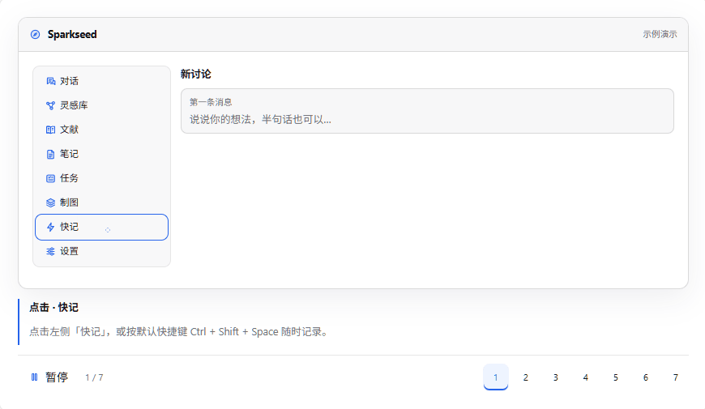
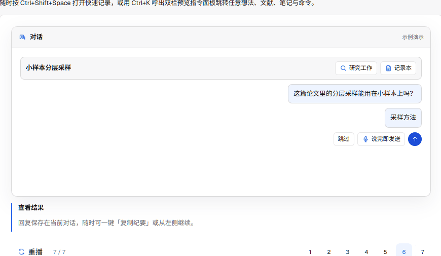

<div align="center">


# Sparkseed · 火种

**把读论文时冒出的问题记下来，带着出处继续研究。**  
**Capture a question as you read, and keep its source in reach as you investigate.**

[下载 Windows 版 · Download for Windows](https://github.com/thewnz/sparkseed/releases/download/v0.3.0/Sparkseed-0.3.0.exe)　·　[全部版本 · All releases](https://github.com/thewnz/sparkseed/releases)

</div>

Sparkseed 是一款面向研究者的 Windows 桌面工具。读到一个值得追问的判断时，你可以一起留下想法、引文和页码。之后再打开这条记录，既能接着讨论，也能回到 PDF 核对原文，把查到的证据整理成笔记、图表或汇报材料。

Sparkseed is a Windows research workspace for the questions that come up while reading. Save a thought alongside a quotation and page number, then come back to discuss it, check the passage in the PDF, or turn your findings into notes, figures and slides.

## 从一句问题开始 · Start with a question

读到分层采样时，你可能会想：“这个方法对小样本也有效吗？” 按 `Ctrl + Shift + Space` 打开快速记录，把问题写下来。选择「保存并讨论」后，可以围绕采样方法继续追问，也可以先存好，等读完论文再回来。

Suppose a paper makes you wonder whether stratified sampling still helps with a small sample. Press `Ctrl + Shift + Space` to capture the question. Choose **Save and discuss** to explore the sampling method with a connected agent, or save it for your next reading session.



## 回到证据所在的那一页 · Trace a claim back to the page

在讨论中选中需要核实的判断，将它加入证据核验台。打开相关论文，选取 PDF 原文并绑定到这条判断。下次整理结论时，可以直接回到对应段落，再看一遍作者的措辞和适用条件。

Select a claim in a discussion and add it to the evidence workspace. Open the relevant paper, highlight the passage and link it to the claim. When you revisit the conclusion, you can return to the source and check the authors’ wording and assumptions.



*两段动图均录自应用内「使用指南」的示例演示。Both clips were recorded from the example walkthroughs in the in-app user guide.*

## 工作区里还有什么 · Explore the workspace

| 工作区 · Workspace | 使用场景 | What you can do |
| --- | --- | --- |
| 灵感库 · Ideas | 按研究价值筛选想法，在关联星图中重看讨论脉络。 | Filter ideas by research value and revisit related discussions on the idea map. |
| 文献与研读 · Papers | 导入 PDF，批注原文，或将 2–4 篇论文并排比较后存入笔记。 | Annotate PDFs or compare two to four papers and save the comparison to a note. |
| 笔记与任务 · Notes & tasks | 用精读、实验或组会模板整理记录，在任务列表里跟踪文献查证。 | Organize reading, experiment and meeting notes, and follow literature checks in the task list. |
| 科研制图 · Figures & slides | 从数据图、流程图或概念示意开始，审核图稿，再用于汇报。 | Create data charts, flowcharts or concept diagrams, review them and use them in a presentation. |

## 安装与使用 · Install and use

1. 下载并运行 [Sparkseed 0.3.0 for Windows x64](https://github.com/thewnz/sparkseed/releases/download/v0.3.0/Sparkseed-0.3.0.exe)。Download and run the Windows installer.
2. 打开「快速记录」写下第一条想法，或在「使用指南」中逐步体验上面的演示。Open **Quick Capture** to save your first idea, or follow the demos in **User Guide**.
3. 记录、阅读和批注可在本地使用。要启用模型追问或翻译，请在「偏好设置 → Agent 接入」配置服务。Capture, reading and annotation work locally. To use AI follow-up questions or translation, connect a provider under **Preferences → Agent access**.

## 从源码运行 · Run from source

在 Windows 上安装 Node.js 24，在仓库根目录打开 PowerShell。  
Install Node.js 24 on Windows and open PowerShell in the repository root.

```powershell
npm.cmd ci
npm.cmd start
```

<details>
<summary>开发命令与致谢 · Development commands and credits</summary>

```powershell
npm.cmd test
npm.cmd run build
npm.cmd run dist:win
```

应用基于 Electron、React、Vite 和 SQLite。CLI 适配参考 [NeoRead](https://github.com/cynicalight/NeoRead)，后台研究任务参考 [DeepSeek SuperAgent](https://github.com/deepseek-ai/dsh-superagent-prototype)。

The app uses Electron, React, Vite and SQLite. NeoRead informed the CLI adapters, and DeepSeek SuperAgent informed the background research tasks. See [第三方声明 · Third-party notices](THIRD_PARTY_NOTICES.md).

</details>

